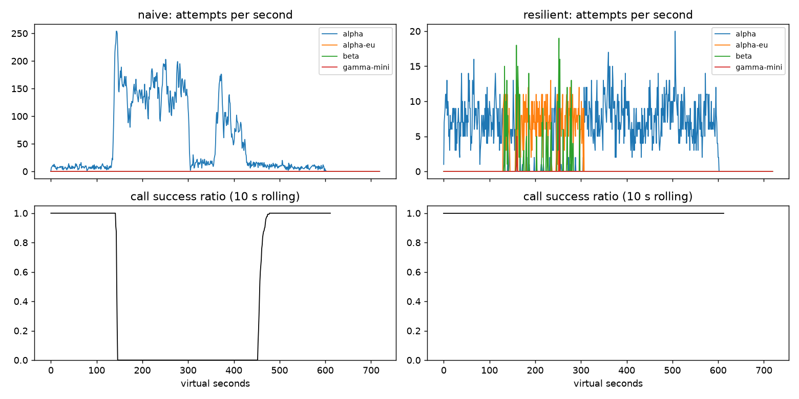

# Lab 25B — Report
**Họ tên / nhóm:** Nguyễn Thị Lê Na · MSV: 2A202602501<br>
**Commit:** `cd20ff9`<br>
**Điểm tự động (`make grade`):** 84 / 88 *(4 điểm SLO trên dữ liệu ẩn do giảng viên chấm)*
## 1. Kết quả Game Day (seed 25)
| Băng | Client | Availability | p95 (s) | Amplification | Retry ratio | Cost/turn | Recovery (s) | PASS? |
|---|---|---:|---:|---:|---:|---:|---:|:---:|
| G1 rate limit | naive | 0.7194 | 7.157 | 7.738 | 6.738 | 2.163 | 4 | No |
| G1 rate limit | yours | 1.0000 | 4.780 | 1.063 | 0.001 | 2.104 | 0 | Yes |
| G2 overload | naive | 0.4560 | 15.034 | 9.904 | 8.904 | 4.627 | 155 | No |
| G2 overload | yours | 1.0000 | 9.922 | 1.035 | 0.004 | 2.106 | 0 | Yes |
| G3 brownout | naive | 1.0000 | 4.768 | 1.164 | 0.164 | 2.328 | 0 | No |
| G3 brownout | yours | 1.0000 | 4.699 | 1.057 | 0.030 | 2.133 | 0 | Yes |
| G4 slow region | naive | 1.0000 | 13.764 | 1.004 | 0.004 | 2.008 | 0 | No |
| G4 slow region | yours | 1.0000 | 5.626 | 1.014 | 0.002 | 2.072 | 0 | Yes |
| G5 bad deploy/quota | naive | 0.3699 | 5.359 | 17.030 | 16.030 | 2.124 | — | No |
| G5 bad deploy/quota | yours | 0.8179 | 5.477 | 1.003 | 0.002 | 2.504 | — | Yes |
| G6 provider outage | naive | 0.5170 | 4.836 | 12.344 | 11.344 | 2.009 | 0 | No |
| G6 provider outage | yours | 1.0000 | 5.949 | 1.051 | 0.017 | 2.228 | 0 | Yes |
The resilient client passed all six tapes at seed 25 and also passed all six at seeds 7, 13 and 42. Its amplification stayed between 1.003 and 1.063 on seed 25. G5 is the closest availability result to a limit: 0.8179 against a minimum of 0.78; malformed 400 requests stop without retry/failover, while quota exhaustion cools down that provider and moves to another.
## 2. Client configuration and rationale
| Parameter | Value | Evidence and reason |
|---|---:|---|
| `attempt_timeout_s` | 8 s | Leaves time for failover inside the 30 s turn deadline. With 30 s, G6 availability fell from 1.0000 to 0.9543 and gave up 101 turns at the deadline plus 8 with no provider; p95 alone looked lower because failed turns are not in successful-turn latency. |
| `max_attempts_per_provider` | 2 | One same-provider retry before moving on. G2 amplification was 1.035; G3 retry ratio was 0.030. |
| `min_time_left_s` | 1 s | Do not dispatch an attempt that cannot get a useful timeout before the turn deadline; G6 at the selected timeout had no give-ups. |
| `backoff_base_s` / `backoff_cap_s` | 0.25 / 4 s | Full jitter spreads retry traffic and caps delay. G1 had 0 retry-after violations with the resilient client and amplification 1.063. |
| `retry_budget_ratio` / initial capacity / refill | 0.10 / 20 tokens / 0.5 token/s | In a breaker-disabled experiment, budget-on G2 had amplification 1.382 and retry ratio 0.058; budget-off rose to 1.595 and 0.392. G3 retry ratio was 0.068 vs 0.163. |
| `quota_cooldown_s` | 300 s | Avoid a provider whose account quota is exhausted. G5 passed with amplification 1.003; client errors remained non-retryable. |
| `breaker.window_size` / `min_calls` | 20 / 5 | Use the last 20 results but wait for five samples before tripping. In G3, lowering the minimum from 10 to 5 cut retry ratio from 0.049 to 0.030 while the tapes still passed. |
| `breaker.failure_rate_threshold` | 0.5 | Open after half the eligible window fails, limiting continued traffic to a provider in sustained trouble. G2 passed with availability 1.0 and amplification 1.035. |
| `breaker.slow_call_s` / `slow_rate_threshold` | 5 s / 0.6 | Count slow successes as unhealthy. In G4, resilient p95 was 5.626 s vs naive 13.764 s. |
| `breaker.open_duration_s` | 10 s | After a short recovery interval, permit controlled probes instead of sending normal volume immediately. |
| `breaker.half_open_max_probes` / `half_open_successes` | 2 / 2 | Cap concurrent probes at two and require two successful, fast probes before closing. |
Luồng `on_error`:
```text
400 / lỗi client    -> release permit -> GiveUp(client_error); không retry, không failover
429 quota           -> release permit -> cooldown provider 300 s -> failover ngay
429 rate limit      -> release permit -> cooldown theo Retry-After -> failover
5xx / 529 / timeout -> ghi failure vào breaker
                       -> retry cùng provider tối đa một lần nếu còn budget,
                          breaker cho phép và còn đủ deadline
                       -> nếu không thì failover sang provider tương thích
success             -> ghi latency vào breaker; slow success cũng tính là xấu
```
Tool call chỉ đi qua `alpha`, `alpha-eu`, `beta`, là các provider có hỗ trợ tool calling; `gamma-mini` chỉ có thể nhận chat thường.
## 3. Ba thí nghiệm
1. **Retry budget là lớp giới hạn cuối khi breaker không bảo vệ.** Đặt `breaker.min_calls=1000000000`, `max_attempts_per_provider=5`; với budget bật, G2 đạt availability 0.9996, amplification 1.382, retry ratio 0.058, recovery 0 s; G3 retry ratio 0.068. Khi đặt `retry_budget_ratio=100`, `retry_budget_max_tokens=1e9`, `retry_budget_min_per_s=1e6`, G2 availability còn 0.9674, amplification 1.595, retry ratio 0.392 và recovery 35 s; G3 retry ratio tăng lên 0.163. Khi breaker hoạt động bình thường, breaker mở để chặn provider đang lỗi, nhưng budget vẫn cần để giới hạn tổng retry trước khi breaker đủ mẫu, trong các lỗi thoáng qua và khi breaker bị cấu hình sai.
2. **Timeout 30 s; xem availability và give-up trước p95.** G4 vẫn availability 1.0; p95 là 5.608 s với timeout 30 so với 5.626 s ở cấu hình 8 s. Ở G6, timeout 30 làm availability giảm từ 1.0000 xuống 0.9543; `give_up_reasons` là `deadline: 101`, `no_provider_available: 8`, trong khi timeout 8 không có give-up. P95 của timeout 30 là 5.407 s, thấp hơn 5.949 s, nhưng đây là selection bias: các lượt thất bại không được tính vào p95 của lượt thành công. Timeout hợp lý phải dựa trên thời gian provider thực tế, khả năng failover còn lại trong deadline và availability; ở đây 8 s giữ đủ thời gian chuyển tuyến và cho G6 availability cao hơn.
3. **Bỏ lọc capability khỏi `ladder()` ở G6.** Bản có lọc đạt availability 1.0000, `incompatible_routes=0`; bản thử nghiệm không lọc chỉ đạt 0.8893 và tạo 264 `incompatible_routes`. Khi provider A hỏng và beta bị siết rate limit, 264 yêu cầu cần tool đã được gửi sang `gamma-mini`, model không có chức năng đó; với người dùng, đó là 264 lượt không hoàn thành đúng yêu cầu, không chỉ là lỗi nội bộ.
## 4. Workflow hoàn tiền
| Executor | Completion | Crashes | Duplicate refunds | Duplicate emails | Lost refunds | Overpaid (cents) | Wasted LLM / crash |
|---|---:|---:|---:|---:|---:|---:|---:|
| naive | 1.000 | 81 | 128 | 81 | 0 | 1,574,200 | 1.123 |
| yours | 1.000 | 66 | 0 | 0 | 0 | 0 | 0.303 |
Cần cả idempotency key lẫn checkpoint. Key ổn định khiến payment/email API trả lại kết quả cũ nếu response bị mất; checkpoint giúp worker mới bỏ qua những bước đã hoàn thành, giảm việc tính LLM lại. Nếu chỉ có checkpoint, crash sau khi payment đã chạy nhưng trước khi lưu checkpoint có thể tạo refund trùng khi restart. Nếu ghi checkpoint trước khi gọi payment, crash ở giữa làm worker mới tưởng đã refund và bỏ qua payment thật, gây mất refund.
## 5. Alerting và error budget
| Sự cố | Mong đợi | Naive alerter | Burn-rate alerter | Độ trễ burn-rate |
|---|---|---|---|---:|
| `checkout_bug` | page | Page | Page | 27 phút |
| `provider_outage` | page | Page | Page | 4 phút |
| `deploy_blip` | none | Page sai | Không page | — |
| `slow_leak` | ticket | Bỏ lỡ | Ticket, không page | 1,337 phút |
| `degraded_evening` | page | Page | Page | 291 phút |
| `night_spike` | none | Page sai | Không page | — |
| `small_bump` | none | Page sai | Không page | — |
Trong 30 ngày, 25,901,755 request có 55,618 request lỗi; availability là 99.7853%. Error budget cho phép 129,508.8 lỗi, nên đã tiêu 42.95%, còn 57.05%; chưa freeze release. `small_bump` kéo dài 20 phút ở 12% lỗi, tương đương khoảng 1.1% ngân sách tháng theo nhãn dữ liệu. Nó không duy trì burn đủ lâu trên cửa sổ dài để page; một spike ngắn như vậy không đáng đánh thức on-call lúc 11 giờ trưa.
## 6. Postmortem — băng G2 với client naive (blameless)

**Tóm tắt.** Từ giây 120 đến 300, alpha chỉ còn 25% capacity do mất 75% GPU; hệ thống đồng thời gặp 529 và slow queue. Client naive tạo amplification 9.904, availability 0.456 và p95 15.034 s. Capacity được khôi phục ở giây 300, nhưng các retry đang tồn tại tiếp tục làm quá tải; recovery metric ghi nhận thêm 155 s mới đạt lại success ratio 95% trong cửa sổ 30 s.
**Ảnh hưởng.** Trong 2,362 lượt, chỉ 1,077 lượt tốt; 1,285 lượt thất bại, tức 54.4%. Nếu tháng chỉ có sự cố này và workload vẫn là 4 turn/s, ngân sách tháng là `0.5% × 4 × 2,592,000 = 51,840` lượt lỗi; G2 tiêu thụ khoảng 2.48% ngân sách đó. Capacity bị giảm 180 s, còn phục hồi ứng dụng kéo dài đến khoảng giây 455 sau khi capacity trở lại.
**Timeline** (giây ảo; attempts/s và success ratio 10 s lấy từ CSV):
| t | Sự kiện | Bằng chứng |
|---:|---|---|
| 119 | Trước sự cố | alpha 9 attempts/s; success ratio 10 s = 1.00 |
| 120 | Alpha còn 25% capacity | alpha 5 attempts/s; 7/7 call hoàn tất trong giây đó |
| 144 | Retry bắt đầu khuếch đại | Đỉnh 254 attempts/s tới alpha; 0/4 call thành công trong giây đó; success ratio 10 s = 0.50 |
| 150 | Mất khả năng phục vụ | 163 attempts/s; success ratio 10 s = 0.00 |
| 180 | Retry storm còn tiếp diễn | 138 attempts/s; success ratio 10 s = 0.00 |
| 300 | Alpha đã được khôi phục | Vẫn 115 attempts/s; success ratio 10 s = 0.00 |
| 420 | Quá tải kéo dài sau khôi phục | 53 attempts/s; success ratio 10 s = 0.00 |
| 455–470 | Bắt đầu hồi phục | recovery metric = 155 s; success ratio 10 s đạt 0.96 ở t=470 |
| 480 | Phục vụ ổn định lại | 11/11 call tốt; success ratio 10 s = 1.00 |
**Trigger và root cause.** Trigger là alpha mất 75% GPU trong ba phút. Root cause là các tầng retry chồng lặp không có jitter, retry budget hay circuit breaker; errors/latency làm retry tăng, retry làm queue dài hơn, queue dài lại gây timeout và retry mới. Sau khi capacity trở lại ở t=300, CSV vẫn ghi 115 attempts/s và 0 success; các request/retry chưa hết deadline tiếp tục chiếm capacity nên hệ thống rơi vào metastable failure. Naive client còn vi phạm `Retry-After` 28,381 lần.
**Điều giúp / điều làm tệ hơn.** Việc khôi phục GPU giúp đưa capacity vật lý về bình thường. Retry không phối hợp, không hủy việc đã quá deadline và không có giới hạn tổng thể làm tải tiếp tục cao hơn capacity phục vụ được; đây là lỗ hổng thiết kế cần sửa ở client và serving stack, không quy lỗi cho cá nhân trực ca.
**Action items**
| # | Hành động | Loại | Owner | Cách kiểm chứng |
|---|---|---|---|---|
| 1 | Chuẩn hóa một tầng retry có jitter và token budget; tắt retry trùng ở SDK/gateway | prevent | SDK team | G2 mọi seed có amplification ≤ 1.2 và 0 retry-after violation |
| 2 | Dashboard/alert cho origin success ratio, attempts per successful call và retry-after violation | detect | SRE/Observability | Synthetic G2 cảnh báo trong ≤ 30 s khi success < 95% hoặc amplification > 1.5 |
| 3 | Hủy retry hết deadline, thêm per-provider admission/concurrency limit và bulkhead | mitigate | Serving platform | G2 recovery ≤ 30 s sau restore, alpha attempts về < 20/s trong 30 s |
## 7. Một điểm yếu còn lại
G2 p95 của client là 9.922 s, chỉ thấp hơn ngưỡng 10 s khoảng 0.078 s; failover tuần tự vẫn có thể chậm nếu nhiều provider cùng degraded hoặc queue tăng đồng thời. Tôi sẽ bổ sung adaptive concurrency và load shedding theo deadline để không đưa thêm việc vào provider đã bão hòa. Kiểm chứng bằng G2 và một tape nhiều provider chậm: availability ≥ 0.99, amplification ≤ 1.1, p95 ≤ 8 s ở mọi seed.
## 8. Cache (Part G)
| Client | Availability | FAQ availability | Cache hit ratio | Stale served | Wrong answers | Outdated answers | Cost/turn | PASS? |
|---|---:|---:|---:|---:|---:|---:|---:|:---:|
| resilient (không cache) | 0.8380 | 0.8430 | 0.000 | 0 | 0 | 0 | 1.386 | No |
| cached | 0.9099 | 0.9599 | 0.648 | 149 | 0 | 3 | 0.920 | Yes |
| Tham số `cache:` | Giá trị | Vì sao (số liệu) |
|---|---:|---|
| `similarity_threshold` | 0.93 | 0.80 tạo 263 wrong answers (`other_question`), FAQ availability 0.8099, cost 1.009. 0.93 có hit 0.648, 0 wrong answer, cost 0.920; 0.97 cũng không sai nhưng hit 0.579 và cost 0.966. |
| `ttl_s` | 60 s | TTL 30: hit 0.585, 2 outdated, FAQ availability 0.9593. TTL 60: hit 0.648, 3 outdated, FAQ availability 0.9599. TTL 300: hit 0.731 nhưng 95 outdated, vượt giới hạn 15. |
| `max_stale_s` | 120 s | Stale-if-error 120 s giữ FAQ availability 0.9599 trong outage. Với 0 s, FAQ availability chỉ 0.8733 và không có stale answer nào được phục vụ. |
| `max_entries` | 50 | Ở thí nghiệm TTL 60 / stale 180, giới hạn 50 và 500 cho cùng kết quả C1 (hit 0.652, FAQ availability 0.964); chọn 50 để giới hạn bộ nhớ, loại entry LRU khi đầy. |
**Thí nghiệm ngưỡng.** `similarity_threshold=0.80` trả nhầm 263 câu gần embedding nhưng khác intent; tất cả được phân loại `other_question`, và FAQ availability giảm còn 0.8099. 0.93 giữ 0 wrong answer trong khi đạt hit ratio cao hơn 0.97 (0.648 so với 0.579), FAQ availability tương đương (0.9599 so với 0.9593) và cost thấp hơn (0.920 so với 0.966). Vì vậy 0.93 là điểm cân bằng tốt hơn cho tape này.
**Thí nghiệm TTL.** TTL 30 làm hit ratio xuống 0.585; 60 nâng lên 0.648 mà chỉ có 3 outdated answer. TTL 300 nâng hit lên 0.731 và cost xuống 0.863 nhưng tạo 95 outdated answer. Webhook chỉ invalidate nguồn đã được thông báo; thay đổi phí ship tại t=480 không có webhook, nên TTL là giới hạn duy nhất cho thời gian một answer cũ về phí ship được coi là fresh.
**Stale-if-error và câu cá nhân.** Khi `max_stale_s=0`, FAQ availability giảm từ 0.9599 xuống 0.8733, thấp hơn mục tiêu 93%; 120 s stale window giữ câu FAQ khả dụng trong outage nhưng vẫn giới hạn tuổi dữ liệu. Không cache câu hỏi cá nhân, kể cả theo user, vì nội dung phụ thuộc trạng thái đơn/tài khoản và quyền truy cập có thể đổi giữa các session; phân tách key theo user không đảm bảo freshness hay authorization hiện tại. Khi stale cache giữ dashboard user-facing xanh, on-call vẫn cần alert riêng theo health/error rate của provider gốc, breaker state, tỷ lệ stale-served và tuổi stale lớn nhất; theo dõi origin availability tách khỏi availability có cache để không che outage.
**Kiểm tra rubric.** Bảng có đủ 6 băng × 2 client; ba thí nghiệm có số trước/sau; workflow trả lời vì sao cần cả idempotency và checkpoint; alerting ghi detection delay, budget và freeze; postmortem có timeline 9 mốc, trigger/root cause, ảnh hưởng, blameless action items có owner và tiêu chí đo; mục 8 có so sánh cache, tham số và ba thí nghiệm.
